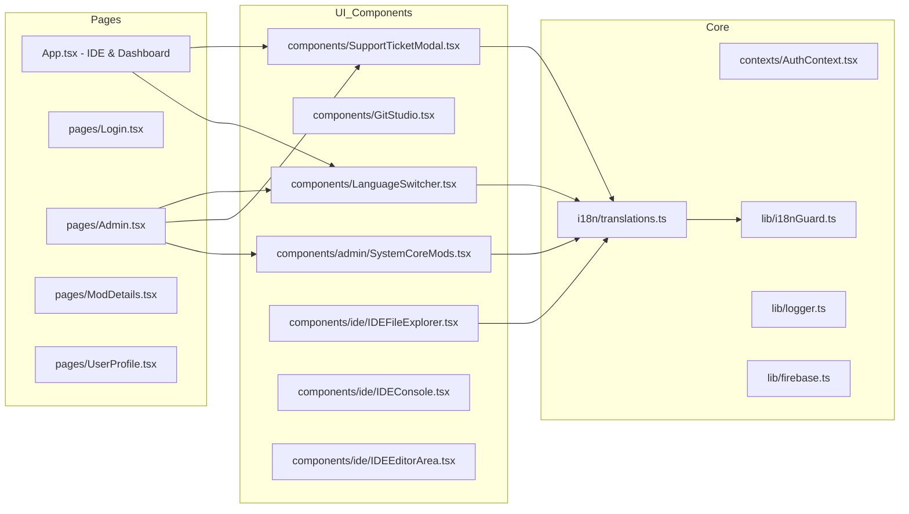
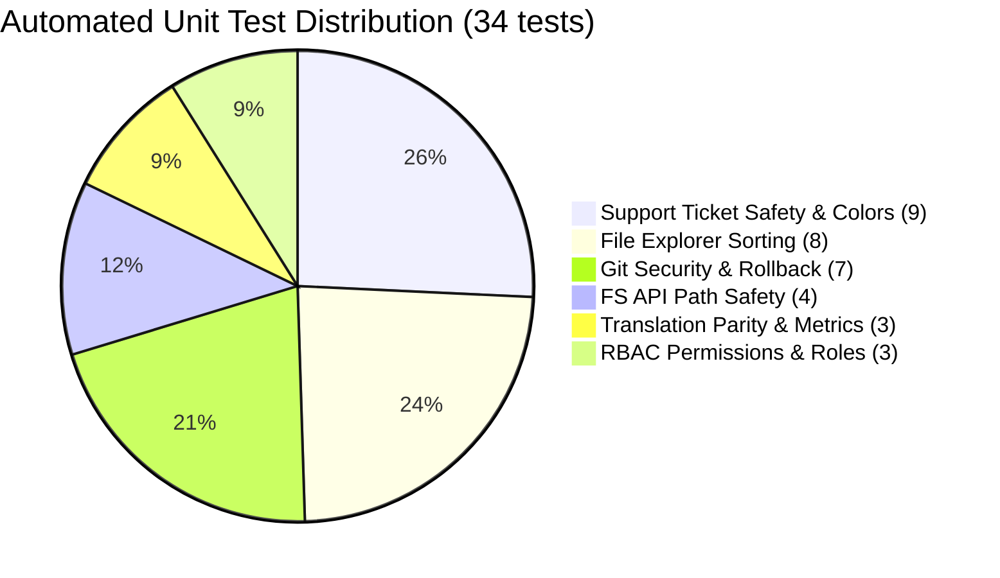
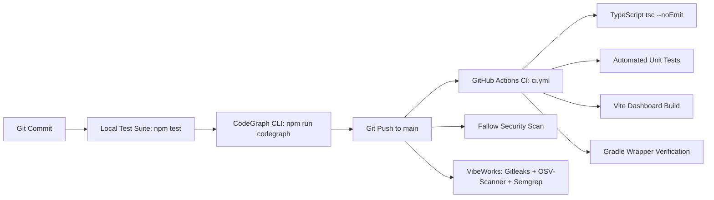

# CodeGraph Documentation

GodHand is an enterprise-grade cloud IDE and collaborative engineering dashboard for Minecraft Java mod development. This document maintains the complete system graph, dependency architecture, security posture, and test coverage generated and maintained via `npm run codegraph`.

---

## 1. System Architecture & Data Flow

```mermaid
graph TD
    subgraph Client [Browser Client - React 18 & Vite]
        UI[IDE & Dashboard Views]
        LS[LanguageSwitcher Component]
        i18n[useTranslation Hook & Event Bus]
        i18nGuard[i18nGuard & Runtime Hardcoded Word Auditor]
        Auth[AuthContext & RBAC Permissions]
        Monaco[Monaco Code Editor]
        GS[Git Studio Component]
        Ticket[Support Ticket Modal - Self-Report Protection]
        SystemMods[System Core Mods - Owner Workspace]
    end

    subgraph Backend [Express Server - Node.js 20]
        Server[Express App server.js]
        FS_API[/api/fs/* Endpoints]
        Git_API[/api/git/* Endpoints]
        Build_API[/api/build & Server Endpoints]
        SystemMods_API[/api/system-mods/* Endpoints]
        Quota[5MB Quota & Path Traversal Validator]
    end

    subgraph Workspace [Local Workspace & Mod Engine]
        GodHandDir[godhand/ Mod Source Tree]
        ModsDir[mods/ Core Mods - arm32-fix]
        GitRepo[.git Repository]
        Gradle[./gradlew wrapper - Java 21]
        JarOutput[build/libs/*.jar]
    end

    subgraph Cloud [Firebase & GitHub Ecosystem]
        Firestore[(Firebase Firestore)]
        FirebaseAuth[(Firebase Authentication)]
        GHActions[GitHub Actions CI / CI.yml]
    end

    UI --> LS
    LS --> i18n
    i18n --> i18nGuard
    UI --> Monaco
    UI --> GS
    UI --> Ticket
    UI --> SystemMods
    UI --> Auth

    Auth --> FirebaseAuth
    UI --> Firestore

    UI -->|REST API Requests| Server
    Server --> FS_API
    Server --> Git_API
    Server --> Build_API
    Server --> SystemMods_API

    FS_API --> Quota
    Quota --> GodHandDir
    SystemMods_API --> ModsDir
    Git_API --> GitRepo
    Build_API --> Gradle
    Gradle --> JarOutput

    GHActions -->|Lint, Tests, Build| Client
    GHActions -->|Gradle Check| Gradle
```

---

## 2. Component Dependency Graph



---

## 3. Backend Endpoints & Security Map

| Endpoint | Method | Security Control | Functionality |
| :--- | :--- | :--- | :--- |
| `/api/system-mods` | GET | Owner/Admin workspace auth | Discovers all core mods in `mods/` and `godhand/` |
| `/api/system-mods/:id/tree` | GET | Path sanitization | Generates recursive directory tree for selected mod |
| `/api/system-mods/:id/file` | GET | Sandbox boundary verification | Reads source code for Monaco editor display |
| `/api/system-mods/:id/file` | POST | 5MB size limit & traversal block | Saves modified source code safely |
| `/api/system-mods/:id/build` | POST | Shell execution sanitization | Triggers compiler pipeline (Gradle / Python builder) |
| `/api/system-mods/:id/download` | GET | Artifact verification | Downloads compiled core mod binary JAR |
| `/api/fs/tree` | GET | Path sanitization | Generates recursive directory tree with sorting |
| `/api/fs/file` | GET | Boundary check | Reads file content with UTF-8 encoding |
| `/api/fs/file` | POST | 5MB size limit, path escape block | Writes/updates source files safely |
| `/api/fs/file` | DELETE | Root escape block | Deletes files from workspace |
| `/api/fs/folders` | GET | Directory filter | Returns list of all available folder paths |
| `/api/fs/move` | POST | Cyclic folder move check | Moves items across directory hierarchy |
| `/api/git/status` | GET | Read-only porcelain execution | Returns modified, staged, untracked counts |
| `/api/git/commit` | POST | Shell sanitization, empty checkpoint check | Creates commits with optional `--allow-empty` |
| `/api/git/restore` | POST | Alphanumeric SHA check, path safety | Restores historical commits or discards files |
| `/api/git/branch` | POST | Regex branch validation | Creates and switches to a new Git branch |
| `/api/git/history` | GET | Log limit cap | Fetches commit log history with hashes and authors |
| `/api/git/diff` | GET | Commit SHA verification | Generates git diff output for selected commit |
| `/api/download-jar` | GET | Artifact presence check | Downloads compiled Minecraft mod JAR |
| `*` | GET | SPA fallback | Serves Vite production single-page application |

---

## 4. Test Suites & Coverage Matrix

Total automated tests: **34 passing tests** across 6 test suites (`npm test`):



1. **`tests/ticket-safety.test.mjs` (9 tests)**:
   - Blocks staff/owner from claiming their own ticket (`self_handling_forbidden`)
   - Blocks assigning ticket to the ticket creator (`cannot_assign_to_reporter`)
   - Blocks filing self-reports against one's own email, username, or targetUser field
   - Blocks duplicate open tickets with identical titles
   - Locks reply input when ticket status is closed or resolved
   - Distinguishes message colors between ticket creator (cyan), staff (indigo), and system (slate)
   - Correctly labels status closed as `Geschlossen` in DE and `Closed` in EN
   - Verifies all required ticket safety and filter keys exist with 100% EN/DE parity
   - Verifies recursive `isAnyFolderOpen` expand-all / collapse-all logic works reliably with initial empty state

2. **`tests/tree-sorting.test.mjs` (8 tests)**:
   - Folders-first then alphabetical
   - Pure alphabetical A-Z & Z-A
   - File extension / type grouping
   - Custom user arrangement order preservation
   - Up / down row repositioning
   - Drag-and-drop before/after insertions
   - Empty/null node graceful handling

3. **`tests/git-safety.test.mjs` (7 tests)**:
   - Rejects empty commit messages
   - Shell command escape and injection prevention
   - Branch name pattern validation
   - Git author attribution sanitization
   - Clean working tree handling via `--allow-empty`
   - Alphanumeric commit hash validation
   - Discard file path traversal protection

4. **`tests/fs-api-safety.test.mjs` (4 tests)**:
   - Path traversal prevention (`../`, `/etc`)
   - Valid in-project paths with stripped leading slashes
   - Self-subfolder cyclic move prevention
   - 5MB file upload quota enforcement

5. **`tests/role-permissions.test.mjs` (3 tests)**:
   - Permanent owner role binding for `OWNER_EMAIL`
   - Tab access restrictions by role hierarchy
   - Support ticket claim and assignment validation

6. **`tests/translations.test.mjs` (3 tests)**:
   - Over 430 dictionary keys per language (100% parity between EN and DE)
   - Zero undefined or empty key mappings
   - Automated missing/hardcoded key warning logging via `i18nGuard`

---

## 5. Security & Quality Pipeline



---

## 6. CodeGraph CLI Command

Run CodeGraph audit and live metrics synchronization at any time:

```bash
npm run codegraph
```
