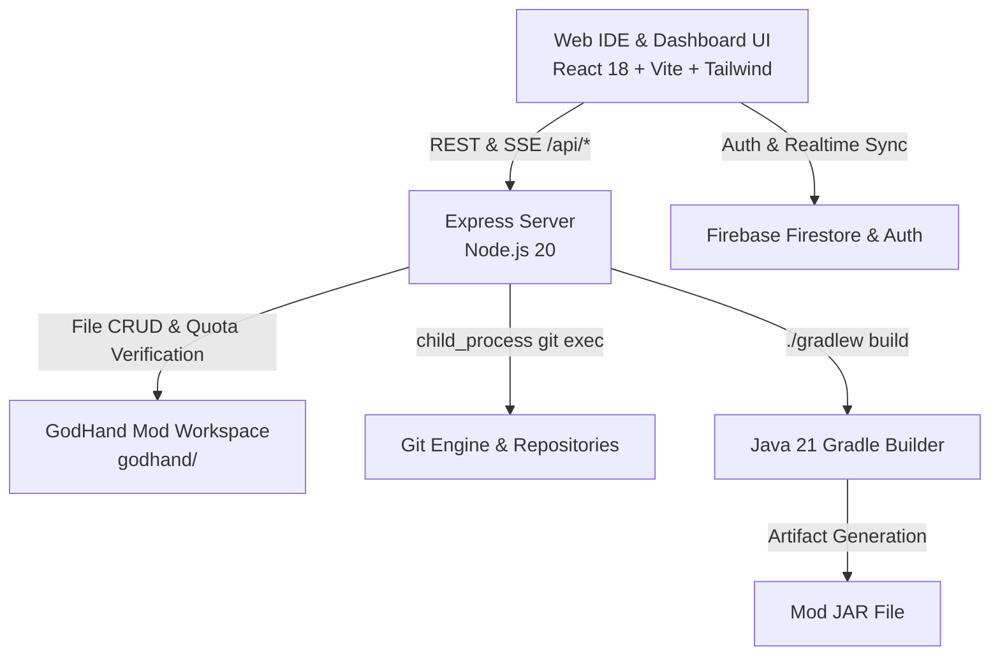

# GodHand Mod Dashboard & Studio

[](https://project-910a2a4c-fa54-4621-b21.web.app)
[](https://github.com/JONIMONI09/GodHand-Studio)
[](https://adoptium.net)
[](https://nodejs.org)
[](https://vitejs.dev)
[](LICENSE)
[](dashboard/src/i18n/translations.ts)

A high-performance web dashboard, cloud IDE, and collaborative engineering studio for developing, compiling, and publishing Minecraft Java mods. Built with React 18, Express, Monaco Editor, and Gradle.

- **🌐 Live Web App**: [https://project-910a2a4c-fa54-4621-b21.web.app](https://project-910a2a4c-fa54-4621-b21.web.app)
- **💻 Local IDE Server**: `http://localhost:3000` (`start-godhand.bat` or `launch-godhand.ps1`)

---

## Key Features

### 1. Interactive File Explorer & Custom Arrangement
- **Arbitrary Ordering (Manual Sorting)**: Move files and folders up or down with dedicated 1-click controls (`ArrowUp` / `ArrowDown`).
- **Drag-and-Drop Reordering**: Drag files directly between sibling rows with visual insertion indicators.
- **Persistent Arrangement**: Custom file order is saved locally and preserved across workspace reloads.
- **Multi-Mode Sorting**:
  - `Custom Arrangement (Manual)`: User-curated hierarchy.
  - `Folders First (Standard)`: Directory groupings prioritized, followed by alphabetical order.
  - `Alphabetical (A → Z)` & `(Z → A)`: Full lexical sorting.
  - `By File Extension / Type`: Groups Java files, configurations, markdown, and assets.
- **Hierarchy Traversal**: Dedicated `CornerLeftUp` and folder-picker dialogs for safe cross-directory movement without path escapes.

### 2. Git Studio with Checkpoints & Version Rollback
- **Checkpoint Milestones**: Create clean checkpoint commits with `--allow-empty` when the working copy is unmodified.
- **Full Version Rollback**: Restore your entire workspace to any historic commit (`/api/git/restore` with action `commit`) with automatic restoration commits.
- **Individual File Reversion**: Discard unwanted changes on a per-file basis or clean the entire tree.
- **Branch Management**: Create, list, switch, and branch off any historical commit hash.
- **Porcelain Status & Diffs**: Real-time visual tracking of staged, modified, added, untracked, and deleted files with unified side-by-side diffs.

### 3. Dynamic Bilingual Localization (EN / DE)
- **100% Parity**: Complete coverage across English and German verified by automated parity tests (`tests/translations.test.mjs`).
- **Live Re-Rendering**: Reactive `useTranslation()` hook and reusable `<LanguageSwitcher />` component ensure instant UI updates across all tabs, dialogs, and modals without page refreshes.
- **Null-Safe Placeholders**: Parameterized string replacements with fallback safety.

### 4. Enterprise Team Dashboard & Role-Based Access Control (RBAC)
- **Role Hierarchy**: Strict permission gates for `owner`, `admin`, `mod`, `supporter`, and `user`.
- **Draggable & Collapsible Layout**: Flexible sidebar with a 160px–480px drag handle and instant collapse button.
- **Discord-Style Team Chat**: Dedicated channels (`#allgemein-team`, `#support-desk`, `#admin-only`, `#owner-audit-log`) with `@member` autocompletion.
- **Quarantined Projects Governance**: Direct permanent deletion of quarantined projects and one-click owner banning with mandatory justification and audit logging.
- **Support & Ticket Center**: Claim tickets, reassign team members, adjust statuses, invite collaborators (`@user`), export standalone styled HTML transcripts, and delete tickets with justification.
- **System Maintenance Controls**: Instant system-wide lockdown and offline safeguards with administrator password verification.

### 5. Multi-Loader Scaffolding & Core Mod Protected Posture
- **Universal Mod Loaders**: Instant project generation for **Fabric, Forge, NeoForge, Quilt, Paper, Folia, Velocity, BungeeCord, and Sponge**.
- **Core Mod Real IDE Editing**: Live file-tree and editor integration for internal engine mods (such as `arm32-fix`) with strict protections: public publishing and abuse reports are disabled.
- **Sample Template Registry**: Mark core mods as sample templates with 1-click toggles for community developers.

### 6. Sandboxed Web IDE, Diagnostic Scanner & Compiler Palette
- **Monaco Code Editor**: Full syntax highlighting, error squiggles, and code navigation for Java, JSON, and Markdown, with duplicate action buttons removed from the editor tab bar.
- **Intelligent Bug & Typo Scanner**: Automated detection of Java keyword typos (`pubilc`, `viod`, `Stirng`), syntax errors, and missing semicolons with 1-click surgical and batch fixes.
- **Terminal Task Palette (`+`)**: Quick execution panel for Gradle targets (`build`, `clean`, `classes`, `test`, `check`, `jar`, `spotlessApply`, `runClient`) alongside custom command inputs.
- **Cloud Gradle Compilation**: Live builds via Gradle wrapper (`./gradlew build`) targeting Java 21, generating downloadable `.jar` artifacts.

---

## Architecture & System Graph



See [CODEGRAPH.md](./CODEGRAPH.md) and [CODEGRAPH_INDEX.md](./CODEGRAPH_INDEX.md) for full architecture graphs and component dependency maps.

---

## Getting Started

### Prerequisites
- Node.js 20+
- npm 10+
- Java 21 JDK (Eclipse Temurin recommended)
- Git 2.30+

### Installation & Run

1. Clone repository:
   ```bash
   git clone https://github.com/JONIMONI09/GodHand-Studio.git
   cd GodHand-Studio
   ```

2. Install root and dashboard dependencies:
   ```bash
   npm install
   ```

3. Launch development server:
   ```bash
   # Windows 1-click launcher
   ./start-godhand.bat
   # Or via npm
   npm run dev
   ```
   Open `http://localhost:3000` in your browser.

---

## Testing & Quality Assurance

The codebase includes **87 automated unit and integration tests** across 12 specialized test suites:

```bash
# Run all automated test suites
npm test

# Run frontend TypeScript type-checking
npm run lint

# Run production build
npm run build
```

| Test Suite | Purpose |
|---|---|
| `tests/auth-safety.test.mjs` | OAuth domain validation, safe auth callbacks |
| `tests/autoscan.test.mjs` | Client-side Java typo detection & auto-fix |
| `tests/client-bridge.test.mjs` | Content-Type JSON parsing safety & host fallbacks |
| `tests/fs-api-safety.test.mjs` | Path traversal protection, 5MB quota, cyclic move blocks |
| `tests/gameplay.test.mjs` | RunClient canvas simulation & HUD status checks |
| `tests/git-safety.test.mjs` | Checkpoints, branch validation, shell escape prevention, rollback |
| `tests/multi-loader-and-compiler.test.mjs` | Multi-loader scaffolding & Gradle task execution |
| `tests/role-permissions.test.mjs` | RBAC hierarchy, tab access, case claims |
| `tests/runtime.test.mjs` | Server runtime health, endpoint safety |
| `tests/ticket-safety.test.mjs` | Ticket audit logs, input sanitization |
| `tests/translations.test.mjs` | 100% dictionary parity (513 keys EN/DE), empty key rejection |
| `tests/tree-sorting.test.mjs` | File Explorer arrangement, custom order, up/down shifts |

---

## Contributing & Security

- Contributions are welcome! Please read our [Contributing Guide](.github/CONTRIBUTING.md).
- To report security vulnerabilities, review our [Security Policy](.github/SECURITY.md).
- All participants must adhere to the [Code of Conduct](.github/CODE_OF_CONDUCT.md).

---

## License

This project is licensed under the [MIT License](LICENSE).
